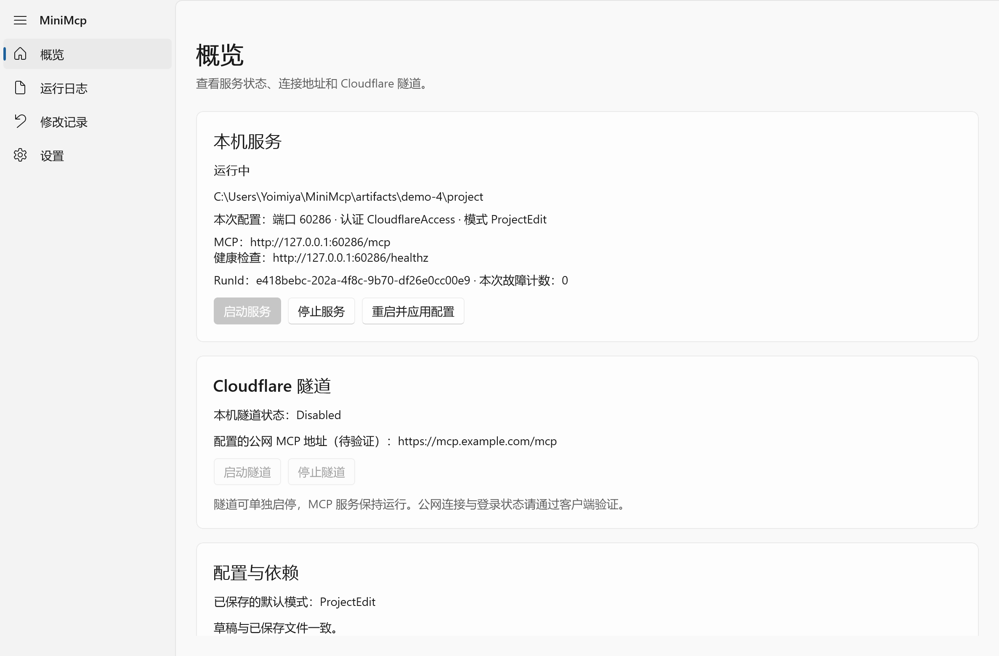
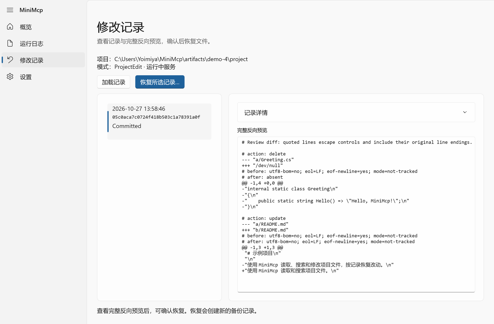
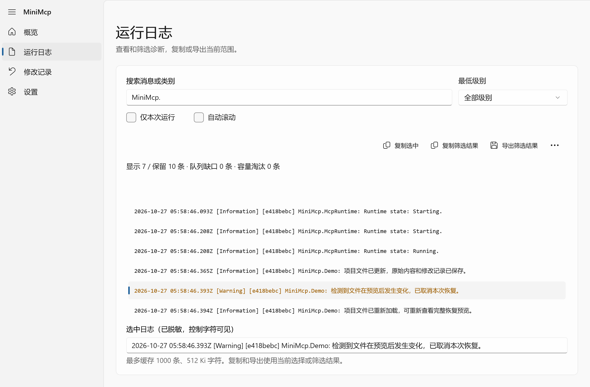
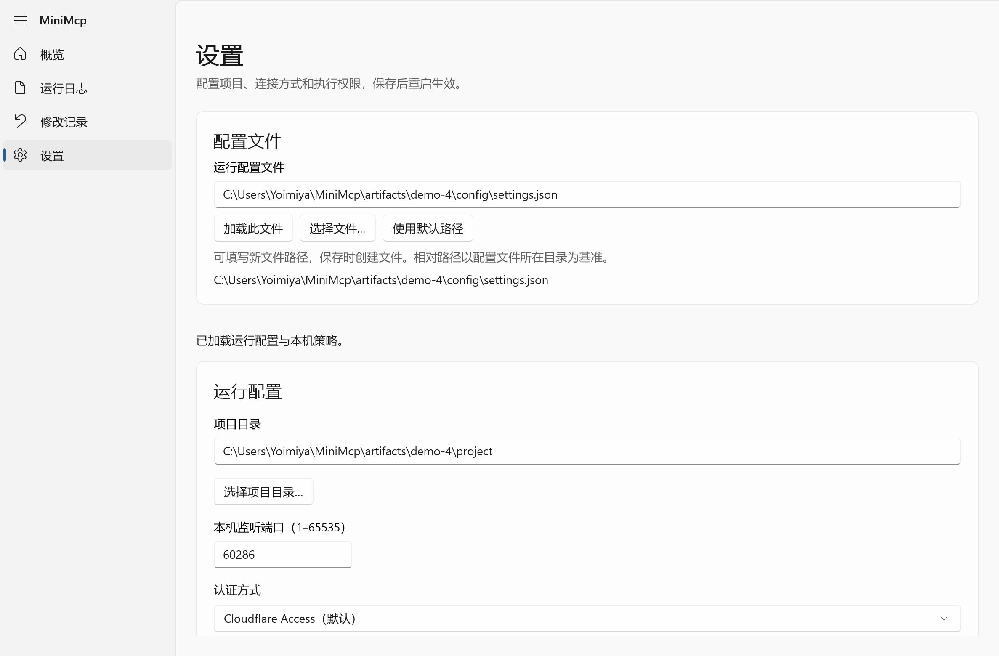
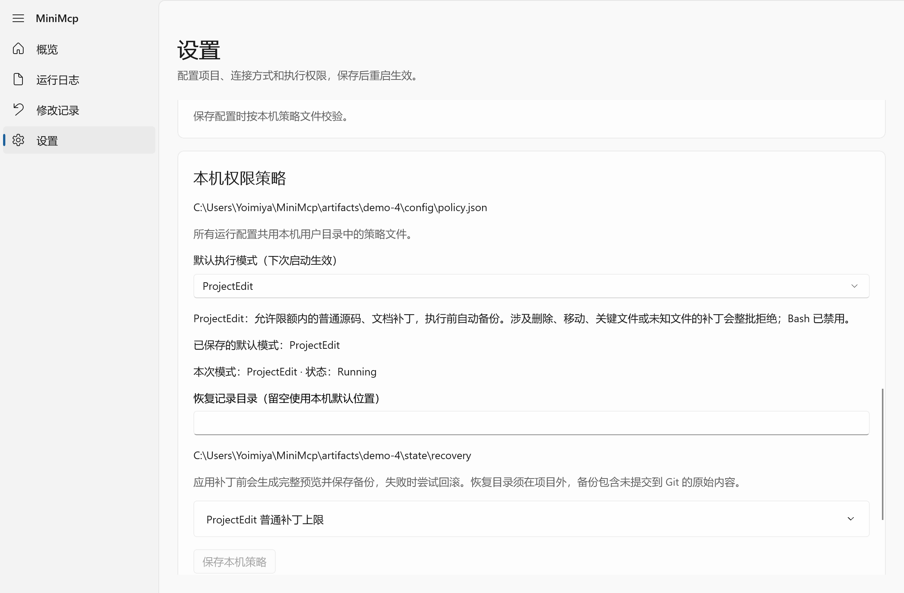
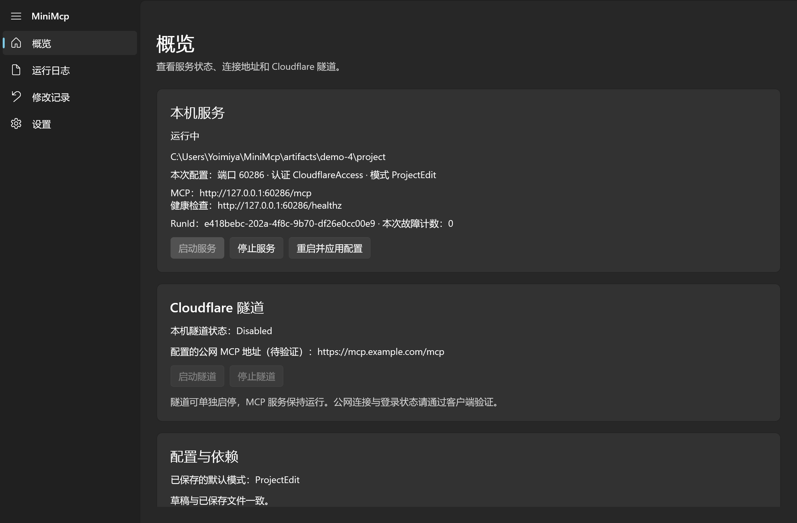

# MiniMcp

MiniMcp 是运行在自己电脑上的 MCP 服务。它通过 Streamable HTTP 提供项目文件读取、目录列表、文本搜索、Git 查询、补丁和 Bash 工具，可从 CLI 或 Windows 桌面窗口启动，也可以通过 Cloudflare Access 和 Tunnel 连接远程客户端。

服务固定提供八个工具：`read_file`、`list_files`、`search_text`、`git_status`、`git_diff`、`git_log`、`apply_patch` 和 `bash`。工具列表在三种模式中保持一致，实际调用受本机策略约束。

| 模式 | 允许的操作 |
| --- | --- |
| ReadOnly | 文件和 Git 查询、补丁预演、查看恢复预览。 |
| ProjectEdit | ReadOnly 的操作，以及限额内的普通源码和文档补丁、本机确认恢复。删除、移动、关键文件、未知类型或超限补丁会整批拒绝。 |
| FullAccess | 通过基础检查的补丁、本机确认恢复和 Bash。Bash 使用运行账号权限，可访问账号有权访问的其他文件和网络。 |

每次实际补丁提交都会保存恢复记录。可在本机查看完整反向预览并确认恢复；记录不覆盖 Bash 或网络操作。客户端的确认提示不会改变服务端权限。详情见 [工具使用](docs/usage.md)和[权限与安全边界](docs/security.md)。

Git 查询会读取仓库本地配置，可能触发其中配置的外部程序；这一点适用于三种模式，外部程序的副作用不包含在恢复记录中。

## 开始使用

需要 .NET 10 SDK。搜索需要单独安装 ripgrep，Git 查询需要 Git；FullAccess 需要 Bash，受管 Tunnel 需要 cloudflared。Linux 的 Bash、受管隧道和文本搜索还需要 `/usr/bin/setsid`。项目不自动下载这些程序。

1. 准备一个已有的项目目录。复制 [本机配置示例](examples/settings.local.json)，将 `projectRoot` 改为该目录的绝对路径。示例使用 Local 认证，仅适合可信的本机环境。
2. 在仓库根目录检查并启动，替换下面的配置路径：

   ```powershell
   dotnet run --project src/MiniMcp.Cli -- check --config C:/path/to/settings.json
   dotnet run --project src/MiniMcp.Cli -- run --config C:/path/to/settings.json --mode ReadOnly
   ```

   Linux 使用相同命令并替换为 Linux 绝对路径。未创建 `policy.json` 时默认 ReadOnly；`--mode` 只影响这次运行。
3. 在同机的 MCP 客户端连接 `http://127.0.0.1:8000/mcp`，端口以配置为准。健康检查为 `http://127.0.0.1:8000/healthz`。结束时在 CLI 按 Ctrl+C。

Windows 用户也可以运行桌面程序，在设置页填写配置并从概览页启动：

```powershell
dotnet run --project src/MiniMcp.Desktop --no-launch-profile
```

公网连接需要配置 Cloudflare Access、OAuth 和 Tunnel；不要直接公开 Local 认证端点。操作步骤见 [Cloudflare 指南](docs/cloudflare.md)。

## 界面预览

截图使用示例配置，按 Windows 200% 缩放保存为原始 PNG；点击可查看大图。

[](docs/images/overview.png)

[](docs/images/recovery.png)

<details>
<summary>运行日志、设置与深色界面</summary>

[](docs/images/logs.png)

[](docs/images/settings.png)

[](docs/images/permissions.png)

[](docs/images/overview-dark.png)

</details>

## 文档

- [配置](docs/configuration.md)：配置文件、路径、认证、依赖和执行模式。
- [使用](docs/usage.md)：CLI、桌面、八个工具及本机恢复操作。
- [权限与安全边界](docs/security.md)：模式矩阵、补丁记录和 Bash 权限。
- [Cloudflare 连接](docs/cloudflare.md)：Access、Managed OAuth、Tunnel 和 ChatGPT 连接。
- [Windows 运行](docs/windows.md) · [Linux 运行](docs/linux.md)：依赖、手动启动、发布和登录后运行。
- [排错](docs/troubleshooting.md)：配置、端口、认证、查询、补丁和恢复问题。

## 检查

```powershell
dotnet run --project tests/MiniMcp.Checks
dotnet run --project tests/MiniMcp.ProtocolChecks
dotnet run --project tests/MiniMcp.RuntimeChecks
```

Windows 还可执行 `dotnet run --project tests/MiniMcp.DesktopChecks`，加上 `-- --ui` 运行实际窗口交互检查。检查需要相关的 Bash、ripgrep 和 Git；Runtime 检查使用 `dotnet run` 或生成的 apphost 启动受控子进程。

## 实现参考与许可证

补丁引擎和进程执行代码使用 C# 实现：补丁格式参考 [OpenAI Codex apply-patch 解析器](https://github.com/openai/codex/blob/main/codex-rs/apply-patch/src/parser.rs)（Apache-2.0）；一次性 Bash 的接口设计参考 [DeepSeek Harness tool-bash](https://github.com/deepseek-ai/deepseek-harness/blob/master/packages/shell/tool-bash/README.md)（MIT）。进程清理使用 Linux [setsid](https://man7.org/linux/man-pages/man1/setsid.1.html) 和 Windows [Job Objects](https://learn.microsoft.com/en-us/windows/win32/procthread/job-objects)。

本项目采用 [MIT 许可证](LICENSE)。
